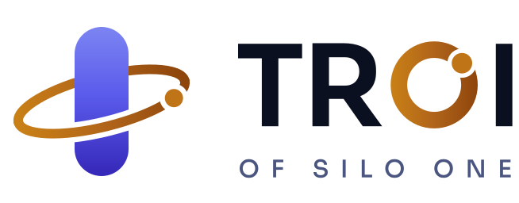

<p align="center">
  <picture>
    <source media="(prefers-color-scheme: dark)" srcset="console/public/brand/lockup-dark.svg">
    
  </picture>
</p>

# Troi of Silo One

A chief of staff that lives on your Mac. Troi listens (hold a key, or say its name), sees when you ask (camera or screen), and does the work: files, apps, its own browser, your calendar, meetings, code reviews, servers, reminders and reports. It keeps its memory in a vault you own and its record on this Mac. It never deletes anything of yours: what should go waits for your approval, then goes to the macOS Trash. Nobody but you can change how it behaves.

## Get started

You need an Apple Silicon Mac on macOS 14 or newer, [Homebrew](https://brew.sh), Google Chrome, and [Claude Code](https://claude.com/claude-code) installed and signed in. If [Arc](https://arc.net) is installed, it becomes the browser the agent drives (shared with you, since Arc runs one instance only); Chrome stays for the hands board and the page tools that run without a window.

```bash
git clone https://github.com/Silo-One-Ug/troi-of-silo-one ~/troi-of-silo-one
cd ~/troi-of-silo-one && ./install.sh
```

The installer adds what is missing and skips what is already there, so it is safe to run again. Then double-click **Troi** on the Desktop, or type `troi` in a terminal. The first run opens the welcome: who Troi is, then the setup (your name, this Mac, a memory, a voice, your phone, a PIN). Your name and a memory are needed; everything else can be skipped and done later. Until you finish, Troi hears but does not answer.

In **System Settings › Privacy & Security**, give Terminal (the app that runs Troi) these permissions: Microphone, Camera, Screen Recording, Accessibility and Input Monitoring. Input Monitoring is what lets the talk key work. The welcome checks Screen Recording, Accessibility and the talk key; macOS asks for the camera and the microphone the first time Troi uses them.

**Updating:** `git pull && ./install.sh`, then start Troi again.

## What is where

| Folder | What it holds |
|---|---|
| `console/` | The console app (Next.js, on http://localhost:3100): the welcome, the conversation, Library, Modes, Routines, Reports, Approvals, Eyes, Browser, and the Face, Hands, Files, Apps and Vault views. On a phone it lays itself out as an app (tabs, a top bar, full-screen views, installable from Safari) |
| `troi-console/` | The agent's server (http://127.0.0.1:8796) and tools: files, apps, eyes, browser, calendar, meetings, reports, Telegram, calls, the guard. `tools.sh` lists them all |
| `backtalk/` | The voice line: speech in, the agent's session, speech out |
| `ai-visualizer/`, `barehands/` | The face and the hands board |
| `vault-template/` | The starting vault the welcome creates when you have none |
| `brand/` | The logo: its generator and typeface; the files it makes are in `console/public/brand/` |
| `data/` | Everything Troi keeps (not tracked; see below) |

`start.sh` starts everything. `install.sh` installs it. `troi-console/setup.py` renders the per-Mac files (the agent's boot file `CLAUDE.md`, `.mcp.json`, `.claude/settings.json` and the components' configs) from `troi-console/templates/`, and installs the background services.

## Your data

Everything Troi keeps lives in `data/`, one folder that you can back up, move or wipe:

| Path | What |
|---|---|
| `data/troi.db` | The record (SQLite): conversations by session, cards, approvals, reminders, the blob index, reports, routine runs |
| `data/blobs/<kind>/` | Every file it makes or receives: `looks`, `screens`, `research`, `imagined`, `telegram`, `meetings`, `reports`, `reviews`, `board`, `uploads` |
| `data/console.json` | Your settings (written by the welcome and the Modes page) |
| `data/vault/` | Your vault, if the welcome made one (you can point Troi at an existing vault instead) |
| `data/backups/` | The previous version of every file edited in the console (to the Trash after 30 days) |
| `data/servers.json` | The servers the pulse watches (`troi-console/servers.py add`) |
| `data/prints/` | Your voice and face prints (they never leave the Mac) |
| `data/logs/`, `data/cache/`, `data/models/`, `data/browser/` | Logs, throwaway files, speech models, and the profile of the agent's own Chrome (with Arc installed, the agent drives your Arc on its own profile instead) |

**Retention.** Camera looks, screenshots and Telegram files older than 14 days go to the macOS Trash, where you can still recover them. Their rows stay in the record, marked archived. Star a picture in the Library to keep it.

**Backups.** Every night at 23:30 two things go to private repos, written as the GitHub account in `github_account` and, when one is set, under the organization in `backup_org` (both in the settings; the welcome's Memory step shows the pair), whichever gh account is active. The vault is committed and pushed to `troi-vault`, or its own remote if it has one. The record and any new files go, as a release, to `troi-of-silo-one-backups` (or `backup_repo`). Missing repos are created on the first run. Backups only ever add; nothing is deleted.

## Secrets

Secrets live only in the macOS login Keychain, under the account `troi-of-silo-one`, with service names `troi-of-silo-one.<name>`:

| Name | What |
|---|---|
| `pin` | The PIN that approves protected changes and trash requests |
| `telegram` | The Telegram bot token (your phone pairs with a code; the pairing is kept in the record) |
| `elevenlabs` | The ElevenLabs key (voice, meeting transcription) |
| `openai`, `gemini` | Keys for making pictures |
| `agora-appid`, `agora-cert` | Voice calls |

The welcome sets them. From a terminal, run `troi-console/keychain.py list` to see which are set (it never shows values), or `troi-console/keychain.py set <name>`.

## Safety

- **Troi never deletes.** Anything bound for the Trash, a force-quit or a risky click becomes an approval. You approve it with the console unlocked (PIN or face), or by sending "approve" on Telegram (it decides the newest request). Requests wait across restarts; risky clicks expire.
- **Only you change how it behaves.** Auto-approve, hands-free and clearing the session go through in your verified voice (or your face), from a console you unlocked, or with your Telegram approval. The protected settings (voice ID, the wake word, the camera and screen sight, learning a face, the face gate, the guard itself) change only from a console you unlocked, with your PIN or your face, or with your Telegram approval. The agent cannot reach its own safeguards. That covers the Keychain, approvals and unlocks, the settings file, the prints, the record, its boot file and Claude Code settings, and the guard's code. `troi-console/guard.py` blocks the attempt whatever the permission mode.
- **Senses stay yours.** The camera is off until you switch it on. Photos and screenshots stay on the Mac and in your private nightly backup; voice and face prints never leave the Mac.

## Services

Four background services run under launchd as `com.troi-of-silo-one.{pulse,ring,telegram,vault-backup}`: reminders and the morning brief, the globe, the Telegram bridge, and the nightly backup. Run `python3 troi-console/setup.py services status` to check them; `restart`, `install` and `remove` do what they say (the nightly backup shows "not running" between runs). Run `troi-console/doctor.sh` for a full check-up.

## More

- [docs/](docs/README.md): the documentation set, published with Mintlify: getting started, talking to Troi, the console, the views, every ability, safety, memory and data, and the reference (the toolbox, `console.sh`, settings, secrets, services, the API, troubleshooting).
- [troi-console/docs/INSTALL.md](troi-console/docs/INSTALL.md): installing in detail, optional pieces, where things are, troubleshooting.
- [troi-console/docs/USAGE.md](troi-console/docs/USAGE.md): what to say, click and do.
- [troi-console/docs/HANDS.md](troi-console/docs/HANDS.md): the native hands, tool by tool.

## Credits and licences

Troi of Silo One is licensed under the GNU Affero General Public License v3.0 ([LICENSE](LICENSE)). It builds on these works, which keep their own licences and notices:

- [backtalk](https://github.com/jaredrhod/backtalk), [barehands](https://github.com/jaredrhod/barehands) and [ai-visualizer](https://github.com/jaredrhod/ai-visualizer) by jaredrhod (AGPL-3.0), in `backtalk/`, `barehands/` and `ai-visualizer/`.
- `vault-template/` is adapted from [ai-memory-vault](https://github.com/jaredrhod/ai-memory-vault) by jaredrhod (CC BY-SA 4.0); the adapted template is shared under the same licence.
- `console/public/space/earth-clouds-4k.jpg` and `milky-way-8k.jpg`: [Solar System Scope](https://www.solarsystemscope.com/textures/) (CC BY 4.0; the Milky Way is based on ESO imagery).
- `console/public/space/earth-blue-marble.jpg`, `earth-night.jpg`, `earth-topology.png` and `earth-water.png`: NASA Visible Earth imagery (public domain), as prepared for the [three-globe](https://github.com/vasturiano/three-globe) examples.
- The wordmark is set in [Sora](https://github.com/sora-xor/sora-font) (SIL Open Font License 1.1, `brand/OFL.txt`); the logo itself was made for Troi of Silo One.
